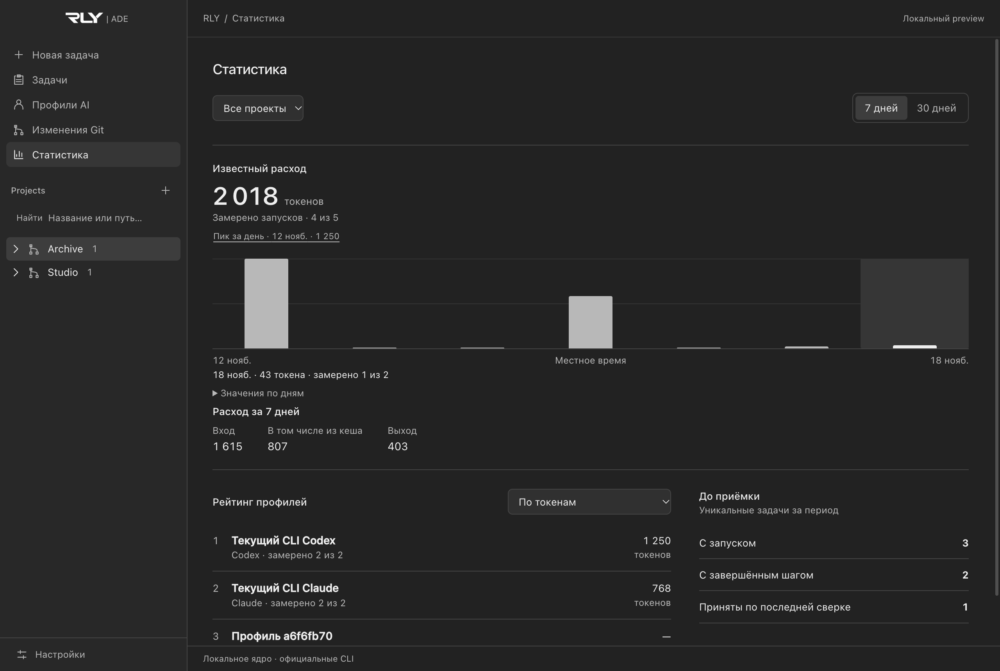

# RLY ADE

Локальное macOS-приложение для разработки с Codex и Claude Code. В одной задаче можно спланировать изменение, поручить разработку другому исполнителю, посмотреть diff, запустить свою проверку и принять результат. Интерфейс на русском.

**0.6.1 · открытая альфа.** Исходники и сборка для своего Mac доступны под MIT. Дополнительный аккаунт подключается через Sign in with ChatGPT (SIWC). Владелец подтверждает использование своего плана в браузере.

## Запуск из исходников

Понадобятся macOS, Git и Node.js 22.13+ с npm. Для запуска задач установите официальный Codex CLI или Claude Code. Проверенный протокол разрешений Codex соответствует версии 0.167.0. Приложение использует установленный Node и после упаковки. В [релизе для Apple Silicon](https://github.com/rly-ecosystem/ade/releases/tag/v0.6.1) опубликован ZIP для macOS 14+ с ad-hoc подписью. Gatekeeper может заблокировать скачанное приложение. На Intel доступна сборка из исходников.

```sh
git clone https://github.com/rly-ecosystem/ade.git
cd ade
npm ci
npm start
```

1. Подключите папку проекта. Запишите требования и сохраните задачу.
2. В «Профили AI» выберите общий вход CLI или добавьте изолированный аккаунт. Вход и выбор профиля для новых запусков — отдельные действия.
3. В задаче откройте «Ход задачи», подтвердите доверие папке и запустите исполнителя. В «Назначения ролей» можно назначить планирование, исследование, разработку и ревью разным профилям.
4. Проверьте запрошенные действия, изменения и результат команды проверки. Приёмка сохраняет версию файлов и требований.

## Что входит

- Потоковая переписка, черновики по задачам, вложенные папки проектов и Git diff.
- Параллельные планирование и исследование, один разработчик и отдельное ревью. Следующие роли получают требования и сводки предшественников.
- Изолированные профили, сохранение назначений на время цепочки и видимый аккаунт каждого ответа. Автопереход при подтверждённом лимите доступен для общего маршрута Codex ↔ Claude.
- «Статистика» показывает лимиты Codex и Claude Code с временем сброса и историю токенов за 7/30 дней, включая запуски вне ADE. Есть рейтинг профилей и моделей. На вкладке «Задачи ADE» доступны фильтр проекта и воронка приёмки.
- Светлая и тёмная темы, управление с клавиатуры и компоновка для узкого окна.



## Сборка и проверки

```sh
npm run typecheck
npm test
npm run build
npm run test:gui
npm run package
```

Пакет появится в `dist/RLY ADE.app`. GUI-проверки требуют графической сессии macOS. Обычные проверки используют временные проекты и тестовые CLI. Проверка экрана входа читает публичную конфигурацию OpenID OpenAI и проверяет отказ через loopback. Проверки с суффиксом `:live` расходуют квоту. Команда `npm run test:siwc:live` открывает браузер для входа во временный профиль, выполняет один короткий запрос к выбранному плану ChatGPT и завершает тестовый сеанс.

[Профили, хранение и статистика](docs/usage.md) · [Как внести изменение](CONTRIBUTING.md) · [Безопасность](SECURITY.md) · [Лицензии](NOTICE)
